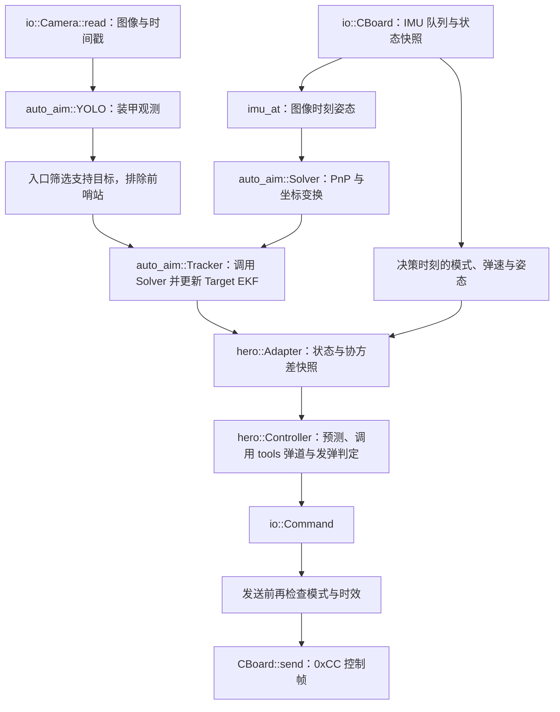

# 英雄自瞄迁入 DGE_vision_26_zzx

日期：2026-10-05。比较对象是本地 `sp25_learn `（目录名末尾有空格）与 `DGE_vision_26_zzx`，迁移以 DGE 现有实现为宿主，仅接入英雄所需功能。实际检查结果单独记录在 [VALIDATION.md](VALIDATION.md)。

新增 `hero` 实机入口、`hero_replay` 离线入口及 `tasks/hero` 决策模块。检测、PnP、坐标转换、整车 EKF、相机和串口继续使用 DGE 原有接口；英雄替换普通自瞄链路中的 `Aimer` / `Shooter` 决策职责，输出原生 `io::Command`。本次未引入前哨站适配。

按“保留必要共享修复”的要求，已将会话编号收回 `hero::Adapter`，DGE 的 `tracker.hpp/.cpp` 恢复为 Git 原始版本。保留目标越界、默认字段初始化、编译类型、遥测快照和串口并发方面的修复。测试默认关闭，显式设置 `BUILD_TESTING=ON` 时才注册测试。

## 两个工程的实际差异

| 比较项 | sp25_learn 当前实现 | DGE 原有实现与本次处理 |
|---|---|---|
| 工程组织 | `src` 组装入口，`io` 管设备，`tasks` 管算法，`tools` 提供工具；已有英雄功能组 | 同样采用 sp-25 分层。新增独立英雄入口和功能组，不替换 `standard` 或 MPC 入口 |
| 检测与解算 | `YOLO → Armor`；`Solver` 负责 PnP、坐标变换及重投影 | YOLO、Solver 接口和算法一致，相关实现主要是注释差异；保留 DGE 文件及模型 |
| 跟踪状态 | `Tracker → list<Target>`，11 维 EKF；有跟踪会话编号 | 保留 DGE 原 Tracker 文件和接口；英雄 Adapter 依据逐帧状态和检测间隔维护自己的会话编号 |
| 两装甲匹配 | 按 `min(3, candidate_count)` 遍历候选 | 原来固定访问前三项，两装甲模型会越界；只迁移边界修复 |
| 观测与目标默认值 | 枚举、布尔值、数值及位姿有初始化 | 原来部分字段未初始化，包括 YOLO 输出后被 Tracker 排序读取的 `priority`；补充默认值 |
| 设备状态 | CBoard 提供带 IMU/状态接收时间的互斥快照 | 原来公开成员跨线程更新，弹速未初始化；新增快照并保留旧 API，英雄入口读取快照 |
| 相机标定 | 源工程拥有另一组相机内外参 | `hero.yaml` 从 DGE 的 `standard3.yaml` 复用相机、内外参和模型参数，不迁移源标定 |
| 串口设备 | 源模板使用 `/dev/ttyACM0` | 英雄模板沿用 DGE `/dev/gimbal`、115200 波特率 |
| CBoard 报文 | `0xAA / 0xBB / 0xCC`，分别为 10 / 9 / 8 字节 | 核心报文一致，保留 DGE 字段、缩放和小端布局；新增状态时效与可选待发队列替换 |
| 旁路雷达包 | 源串口解析器处理 33 字节 `0x5A` 包 | DGE 原解析器处理 29 字节包。本次保留 DGE 原分支，不迁入源 33 字节修改 |
| 原 `standard.cpp` | 源入口还存在本地学习、调试改动 | DGE 原入口强制自瞄与 24.5 m/s 弹速；不搬入英雄链路，英雄读取真实模式和弹速 |
| 原 Shooter 编译 | 源工程与 DGE 的共享库内容存在差异 | DGE `std::min(multiplier, 2)` 混用 double/int 导致模板推导失败；仅将常量改为 `2.0`，保持算法数值，英雄仍不调用原 Shooter |
| 构建 | 源工程有英雄及 CTest、core-only 目标 | 在 DGE 注册这些目标；子目录沿用顶层 OpenVINO 配置，顶层保留原默认位置并允许用户覆盖 |

比较不是整目录同步。DGE 的相机 SDK、USB 相机、Gimbal、YOLO 模型、分类器、原 `Aimer` / `Shooter` / Planner / `tools::Trajectory`、其他兵种入口以及原有配置保持其宿主实现。

## 迁移范围与行为

`hero_core` 使用 C++17 标准库及原生纯数据类型 `io::Command`，负责英雄决策，并调用 `tools/ballistics.hpp/.cpp` 中的通用弹道工具。弹道接口为 `tools::BallisticConfig`、`tools::BallisticSolution`、`tools::solve_ballistic()` 和 `tools::valid_ballistic_config()`，不依赖英雄目标、跟踪或设备类型。`hero_adapter` 是 YAML / Eigen / `auto_aim::Target` 到核心快照的转换层，不直接控制设备。

通用弹道单独注册为轻量静态库 `tools_ballistics`，其他模块可通过 `#include "tools/ballistics.hpp"` 和 `target_link_libraries(目标 PRIVATE tools_ballistics)` 复用；原 `tools` 目标也公开链接该库。core-only 模式仅构建这个工具库和英雄核心，保留无视觉/设备依赖的测试能力。原 `tools::Trajectory`、普通 `Aimer` / `Shooter` 的实现及调用方式保持不变；本次只调整新弹道代码的归属和接口命名，不改变求解公式、默认参数或英雄策略。

普通车辆低转速时预测未来装甲位置；高速旋转时根据角速度切换到面向云台一侧的定点策略，在预计到达时检查装甲朝向和空间窗口。四装甲模型保留交替半径及高度，两装甲和原有基地大装甲模型通过同一接口接入。英雄预测使用“帧至决策时延 + 出膛延迟 + 飞行时间”，在快照上迭代求解，不推进 Tracker 的 EKF。

弹道采用二维二次阻力模型，使用 RK4 积分和有界扫描/二分求低弹道。无效弹速、不可达目标、不收敛或非有限输入撤销控制。英雄参数独立，不使用普通自瞄的低弹速回退。

发弹判定综合 tracking 稳定帧数、图像与遥测时效、有效弹道、到达窗口、当前 yaw/pitch 对准、相位不确定性及最小间隔。`shoot=true` 是一次更新中的请求脉冲；原 CBoard 没有累计出弹确认字段，视觉不能据此确认实际出弹。相位方差只传播当前相位/角速度协方差，不包含未来过程噪声或完整弹速/延迟分布，不能解释为完整命中概率。

英雄入口只接受模式 1（`auto_aim`）；模式 4（`outpost`）不启用英雄控制。前哨站观测在 Tracker 之前过滤，Adapter 再次拒绝前哨站目标。没有新增前哨站半径、初始化、过程噪声、专用策略或 `outpost_only` 配置。原 CBoard 模式 4、Solver 几何、Tracker 丢失计数和 `outpost_max_temp_lost_count` 保留，属于 DGE 既有共享接口。

本次不迁移源项目标定、33 字节雷达协议修改、模型权重、驱动、其他兵种入口或源工作区的学习改动；不实现 `CALIBRATION_CHANGE_PLAN.md` 中尚处于设计阶段的拟合工具、正向弹道评估或枪口平移扩展。

算法行为参考 [HUST_HeroAim_2024](https://github.com/HUSTLYRM/HUST_HeroAim_2024) 的旋转目标定点等待及到达/出膛延迟补偿，再按 sp-25 已有 EKF 状态实现。源项目已核实参考版本 `8fe6bf9f2fa16305fefdf5905fe592a729bf96dd`（检索日期 2026-09-30）与 MIT 许可；保留 [许可文本](HUST_HeroAim_2024_LICENSE)。本次不重新迁入 HUST 的驱动、运行框架或整套源码。

## 数据流与生态接口



`Tracker` 持有 `Solver` 引用，在 `set_target()` / `update_target()` 内对所选观测调用 `solve()`；入口不会预先对全部装甲重复执行 PnP。原生数据类型沿用 `cv::Mat → list<Armor> → list<Target> → io::Command`，符合 DGE / sp-25 的感知、估计、决策和输出分工。

解算观测前，以 `imu_at(image_time + imu_time_offset)` 设置 Solver。推理完成后重新读取 CBoard 快照，经同一坐标变换获得当前对准姿态。Adapter 只读取 11 维状态和相位/角速度协方差，并维护英雄自己的 `session_id`，不要求原 Tracker 新增接口。英雄仅接受 `tracking`，`detecting`、`temp_lost`、`lost`、切换模式或过期数据撤销控制。重新启用时重建 Tracker、清理稳定计数，控制器保留已请求发弹的间隔限制。

Adapter 应接收每一帧 Tracker 的结果。首次有效目标、重新进入 `detecting`、检测阶段出现超过 100 ms 的帧间隔时建立新会话；短暂 `temp_lost` 后恢复同一目标时保持编号。调用方替换 Tracker 时调用 `Adapter::reset_tracking()`，该方法不清除会话计数、已见帧时间或 Controller 的发弹冷却。原 Tracker 的头依赖与状态机保持原样。

图像、遥测接收、决策与发送检查统一使用 `steady_clock`。相机时间戳和 IMU 接收时间是主机侧时间，固定 `imu_time_offset` 仍需实测；原 Solver 的 world 是 IMU 参考坐标，不提供地图定位或自车里程计。

### 单位和报文约定

| 内容 | 约定 |
|---|---|
| EKF 状态 | `[cx, vx, cy, vy, cz, vz, angle, omega, radius, radius_delta, height_delta]` |
| 长度 / 速度 / 时间 | m / m/s / s |
| 英雄角度 / 角速度 | rad / rad/s；不要把原顶层检测参数中的 degree 值填进 `hero` |
| 弹道 pitch | 向上为正 |
| `io::Command.pitch` | 沿用宿主，向上为负；`hero.pitch_offset` 是向上为正的补偿量 |
| 阻力参数 | `drag` 单位 1/m；`drag=0` 是无阻力基线 |
| `0xAA` 接收 | 10 字节：帧头、int16 `w,x,y,z` ×10000、`0xDD` |
| `0xBB` 接收 | 9 字节：帧头、int16 弹速 ×100、mode、ShootMode、ft_angle ×10000 |
| `0xCC` 发送 | 8 字节：帧头、uint8 control/shoot、int16 yaw/pitch ×10000、`0xEE` |

报文未新增 CRC、角速度、角加速度或额外距离字段。`io::Command.horizon_distance` 保持默认值。`send(command, true)` 只替换队列中尚未被发送线程取出的旧包，旧调用默认维持原队列行为；已经取出的包和已发送的包无法撤回。

## 配置、构建与运行

`configs/hero.yaml` 的检测模型、相机参数、内外参来自 **DGE 的 `configs/standard3.yaml`**，设备沿用 `/dev/gimbal`。这说明模板接入宿主配置，不代表已经完成英雄本车标定。默认 `hero.calibration_confirmed=false`，实机入口会在打开设备前退出；`hero.auto_fire=false`，自动发弹关闭。出膛延迟、弹速范围、阻力和窗口均需要本车测量或核对。

以下命令从 `DGE_vision_26_zzx` 项目根目录执行。完整构建使用工程已有的 OpenCV、Eigen、yaml-cpp、fmt、spdlog、nlohmann_json、OpenVINO、libserial、libusb 和海康 SDK，未增加算法运行时依赖。

`BUILD_TESTING` 默认是 `OFF`，避免默认构建额外注册英雄测试；以下验证命令显式开启它。C++17 要求由 `tools_ballistics` 和英雄 core 目标声明，没有额外强制全工程的 `CMAKE_CXX_STANDARD_REQUIRED`。

```bash
cmake -S . -B build/hero -DBUILD_TESTING=ON
cmake --build build/hero --target hero hero_replay hero_core_test hero_integration_test hero_cboard_test -j2
ctest --test-dir build/hero --output-on-failure -R '^hero_'
```

OpenVINO 默认目录仍为 DGE 原 `/opt/intel/openvino_2024.6.0/runtime/cmake/`。若安装位置不同，在首次配置时传入 `-DOpenVINO_DIR=/实际路径/runtime/cmake`；其他已安装于独立前缀的依赖可通过 `-DCMAKE_PREFIX_PATH=/实际依赖前缀` 指定。

无需相机 SDK、串口或推理依赖的核心构建：

```bash
cmake -S . -B build/hero-core -DSP_HERO_CORE_ONLY=ON -DBUILD_TESTING=ON
cmake --build build/hero-core -j2
ctest --test-dir build/hero-core --output-on-failure
```

完成英雄本车相机/IMU 外参核对、时间同步和弹道参数测量后，再设置 `hero.calibration_confirmed=true`；先保持 `hero.auto_fire=false` 检查坐标、重投影与云台跟随。

```bash
./build/hero/tasks/hero/hero configs/hero.yaml --display=true
```

离线回放输入为原生 Recorder 的 `<prefix>.avi` 与 `<prefix>.txt`，文本每行 `seconds w x y z`。示例中的 `/实际录像目录/run` 需要替换成已有配对录像前缀，DGE 不随本次迁移新增源项目 demo。

```bash
./build/hero/tasks/hero/hero_replay /实际录像目录/run \
  --config=configs/hero.yaml --speed=15 --latency=0.005 --output=/tmp/hero_replay.csv
```

回放不创建 Camera / CBoard 实例，不写串口。原录像不含弹速、模式或实际推理耗时，因此 `speed`、`latency` 是显式模拟参数，不能用于证明实机时延。CSV 包含跟踪状态、拒绝原因、控制/发弹标志、角度、飞行时间、相位及瞄准点；精度分析需要录像对应的标定。

## 所有改动文件

当前迁移共涉及 **28 个文件：新增 16 个、修改 12 个**。其中 11 个修改属于共享层和构建，另 1 个是根说明文档。弹道两个新增文件已从 `tasks/hero` 移到 `tools`，原先的 Tracker 两个修改文件已恢复，构建生成物不计入清单。

| 文件 | 类型 | 改动及必要性 |
|---|---|---|
| `tasks/hero/CMakeLists.txt` | 新增 | 注册 core、adapter、实机、回放与三组测试目标；core 链接通用弹道库 |
| `tools/ballistics.hpp` | 新增 | `tools::` 通用弹道参数、求解结果及校验接口 |
| `tools/ballistics.cpp` | 新增 | 通用 RK4 二次阻力积分与有界低弹道求解，无英雄或设备依赖 |
| `tasks/hero/controller.hpp` | 新增 | 原生 Command 对接、目标快照与英雄配置/决策类型 |
| `tasks/hero/controller.cpp` | 新增 | 未来预测、跟随/定点、窗口、对准、时效与发弹间隔 |
| `tasks/hero/adapter.hpp` | 新增 | DGE Target 到核心的桥接接口 |
| `tasks/hero/adapter.cpp` | 新增 | YAML 校验、EKF 状态/协方差映射、英雄会话编号及前哨站拒绝 |
| `src/hero.cpp` | 新增 | CBoard 英雄主循环、真实遥测、模式/时效检查及显示 |
| `src/hero_replay.cpp` | 新增 | 读取原生 AVI/TXT 录像并输出逐帧 CSV |
| `tests/hero_core_test.cpp` | 新增 | 通过 `tools::` 接口检查弹道及异常输入，并验证旋转车辆、对准和时序 |
| `tests/hero_integration_test.cpp` | 新增 | 原始 Tracker 与英雄 Adapter；车辆、两装甲、基地、失锁/恢复/检测间隔/模式重置后的会话及非零姿态坐标链检查 |
| `tests/hero_cboard_test.cpp` | 新增 | Linux PTY 分包、噪声、遥测时间戳、模式及报文字节检查 |
| `configs/hero.yaml` | 新增 | DGE 视觉/标定/串口配置加独立英雄参数；默认未确认标定、关闭发弹 |
| `docs/hero/HUST_HeroAim_2024_LICENSE` | 新增 | 保留行为参考项目 MIT 许可 |
| `docs/hero/MIGRATION.md` | 新增 | 两工程比较、范围、数据流、使用与完整文件清单 |
| `docs/hero/VALIDATION.md` | 新增 | 本次实际构建与检查记录，明确验证边界 |
| `CMakeLists.txt` | 修改 | 注册英雄与 CTest、测试默认关闭、增加 `SP_HERO_CORE_ONLY` 并在该模式注册通用弹道库；允许覆盖 OpenVINO 默认路径 |
| `tools/CMakeLists.txt` | 修改 | 注册无视觉/设备依赖的 `tools_ballistics` 库；普通 tools 公开链接，core-only 跳过其他工具 |
| `tasks/auto_aim/CMakeLists.txt` | 修改 | 沿用顶层 OpenVINO 配置，避免覆盖用户选择 |
| `tasks/omniperception/CMakeLists.txt` | 修改 | 同上；未移植全向感知算法或改变其运行入口 |
| `tasks/auto_aim/armor.hpp` | 修改 | 补充灯条/装甲默认值，消除未初始化字段读取 |
| `tasks/auto_aim/target.hpp` | 修改 | 初始化公开元数据，支持默认及合成目标构造 |
| `tasks/auto_aim/target.cpp` | 修改 | 候选遍历限定为 `min(3, size)`，修复两装甲越界 |
| `tasks/auto_aim/shooter.cpp` | 修改 | 既有共享库编译类型修复：`std::min(multiplier, 2)` 改为 `std::min(multiplier, 2.0)`，数值行为保持一致，英雄不调用此 Shooter |
| `io/cboard.hpp` | 修改 | 增加互斥状态快照及可选替换待发队列参数 |
| `io/cboard.cpp` | 修改 | 初始化状态、记录有效遥测时间/姿态、非法模式置 idle、限制插值并修正日志 |
| `io/socketserial.hpp` | 修改 | 可选替换待发队列、消除写队列的未加锁读取；保留 DGE 29 字节雷达分支 |
| `readme.md` | 修改 | 增加英雄入口及迁移/验证文档链接 |

原入口仍可使用原 API；其直接读写 CBoard 公开成员的历史并发方式未在全工程统一改造。新英雄入口通过互斥快照读取状态。硬件标定、实际发弹反馈、下位机单发脉冲处理和云台响应应通过本车联调确认；本次执行过的检查以 [VALIDATION.md](VALIDATION.md) 为准。
